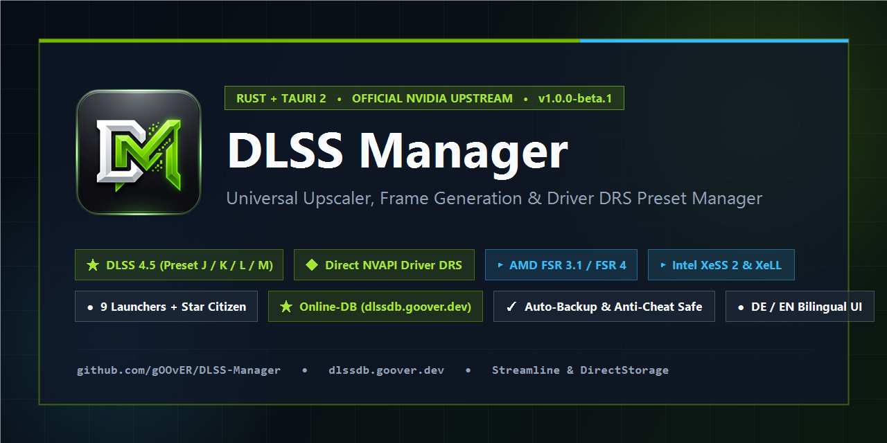

<div align="center">
  

  # DLSS Manager

  **High-Performance Rust + Tauri 2 Universal Upscaler, Frame Generation & NVIDIA Driver DRS Preset Manager for Windows & Linux**

  [](https://github.com/gOOvER/DLSS-Manager/actions/workflows/rust-ci.yml)
  [](https://github.com/gOOvER/DLSS-Manager/releases/latest)
  [](https://www.virustotal.com/gui/file/19f89ceaac131278854c5a0733a1e1c632fc5477116f786466b1e35edbdf5848)
  [](wiki/Home.md)
  [](#building-from-source)
  [](https://dlssdb.goover.dev)
  [](#installation)
  [](LICENSE)
  [](CONTRIBUTORS.md)
  [](https://donate.goover.dev)
</div>

---

## 📋 Contents

- [Overview](#-overview)
- [📚 Wiki & Full Documentation](#-wiki--full-documentation)
- [Key Features](#-key-features)
- [Supported Game Launchers](#-supported-game-launchers)
- [📊 DLSS Version, Preset & Hardware Reference Matrix](#-dlss-version-preset--hardware-reference-matrix)
  - [1. NVIDIA DLSS Version History & Supported Presets](#1-nvidia-dlss-version-history--supported-presets-nvngx_dlssdll-nvngx_dlssddll-nvngx_dlssgdll)
  - [2. NVIDIA DLSS Presets Breakdown](#2-nvidia-dlss-presets-breakdown)
  - [3. All Supported Upscaler & Streaming Technologies](#3-all-supported-upscaler--streaming-technologies)
- [☁️ Online Game Compatibility & Settings Database (`dlssdb.goover.dev`)](#️-online-game-compatibility--settings-database-dlssdbgooverdev)
- [Installation](#-installation)
- [Building from Source (Rust + Tauri 2)](#-building-from-source-rust--tauri-2)
- [Contributors](#-contributors)
- [License & Credits](#-license--credits)

---

## 🚀 Overview

**Why DLSS Manager?** Previously, getting the latest DLSS 4.5 files and forcing optimal Transformer presets (`Preset K / L / M`) required juggling **multiple separate tools and manual hacks** — one tool to swap DLL files, *NVIDIA Profile Inspector* to edit driver DRS flags, manual text/hex edits in `ApplicationStorage.json` & `fingerprint.db` to stop **NVIDIA App** from resetting non-whitelisted games (like *Star Citizen*), and `.reg` files to toggle the DLSS On-Screen Overlay. **DLSS Manager was created to replace all of those with a single, fast all-in-one tool.**

**DLSS Manager** (`v1.0.0+`) is a complete ground-up **Rust + Tauri 2** desktop application that automatically discovers installed games across **9 game launchers**, inspects their **NVIDIA DLSS 4.5 / 5**, **Intel XeSS 2**, **NVIDIA Streamline**, and **Microsoft DirectStorage** binaries via zero-allocation Win32 PE `VS_FIXEDFILEINFO` parsing, verifies cryptographic Authenticode signatures (`WinVerifyTrust`), updates them from official upstream sources with automatic rollback backups, and configures **Global & Per-Game NVIDIA Driver DRS Presets (`Preset J / K / L / M / F`)** directly via `nvapi64.dll` — including a 1-click **NVIDIA App Override Whitelist Unlocker**.

---

## 📚 Wiki & Full Documentation

Complete technical documentation, guides, and troubleshooting are available in the **[`wiki/`](wiki/Home.md)** directory and on the **[GitHub Wiki](https://github.com/gOOvER/DLSS-Manager/wiki)**:

| Wiki Guide | Summary |
| :--- | :--- |
| **[🏠 Wiki Home](wiki/Home.md)** | Main overview, feature matrix & quick navigation |
| **[🚀 Installation & Quick Start](wiki/Installation-and-Quick-Start.md)** | Portable `.exe`, NSIS/MSI installers, Winget, UAC Administrator privileges, `%LOCALAPPDATA%\gOOvER\DLSS-Manager` storage layout & 1-minute setup |
| **[📊 DLSS 4.5 / 5 Presets (A–M) & Versions](wiki/DLSS-Presets-and-Versions.md)** | Complete DLSS version history (`v2.0` to `v310.9.16+`), 74.18 MB full build vs. slim builds, Preset `J / K / L / M / E / F`, DLSS-G Multi-Frame Generation (`2×–6×`) & all managed DLLs |
| **[🎛️ NVIDIA Driver DRS & NVIDIA App Whitelist](wiki/NVIDIA-Driver-DRS-and-NVIDIA-App-Whitelist.md)** | How `nvapi64.dll` DRS works, why NVIDIA App resets overrides to `0`, how the 1-click Whitelist Unlocker works & in-game verification via the DLSS On-Screen Overlay |
| **[🎮 Launchers, Star Citizen & Anti-Cheat](wiki/Supported-Launchers-and-Anti-Cheat.md)** | Multi-drive detection (`A:\`–`Z:\`) across 9 launchers, dedicated **Star Citizen** EasyAntiCheat & Driver DRS guide, manifest verification & Authenticode checks |
| **[☁️ Online Database (`dlssdb.goover.dev`)](wiki/Online-Compatibility-Database.md)** | Personal API key setup, profile syncing, `unverified` auto-discovery with SteamDB/PCGamingWiki links & 1-click community reporting |
| **[🛠️ Architecture & Building from Source](wiki/Architecture-and-Building-from-Source.md)** | Rust backend modules, SQLite schema, build prerequisites & Windows 11 Smart App Control tips |
| **[❓ Troubleshooting & FAQ](wiki/Troubleshooting-and-FAQ.md)** | Common questions & solutions (NVIDIA App resets, missing/duplicate games, backup restoration, anti-cheat protection) |

---

## ✨ Key Features

<table>
  <tr>
    <td width="33%" valign="top">
      <h3>🦀 Native Rust + Tauri 2 Engine</h3>
      Instant startup, low memory footprint, embedded <strong>SQLite (WAL + FTS5)</strong> database, connection-pooled async HTTP engine, and native Win32 PE version parser without loading untrusted DLLs into memory.
    </td>
    <td width="33%" valign="top">
      <h3>🎛️ Direct NVIDIA Driver DRS Presets</h3>
      Configure global and per-game <strong>DLSS Super Resolution (Preset J / K / L / M)</strong>, <strong>Ray Reconstruction (Preset D / F)</strong>, and <strong>Frame Generation (Preset A / B / Latest)</strong> directly in the NVIDIA driver via <code>nvapi64.dll</code> — including automatic startup enforcement and clean profile deletion (<code>NvAPI_DRS_DeleteProfileSetting</code>).
    </td>
    <td width="33%" valign="top">
      <h3>🟢 Official NVIDIA Upstream Only</h3>
      Fetches DLSS 4.5 binaries exclusively from official NVIDIA upstream sources (<code>NVIDIA/DLSS</code> GitHub repository &amp; local official NVIDIA GeForce Driver NGX OTA model cache <code>C:\ProgramData\NVIDIA\NGX\models\</code>), preferring the full <strong>74.18 MB all-presets production build</strong> and blocking watermarked dev builds (<code>310.7.*</code>).
    </td>
  </tr>
  <tr>
    <td valign="top">
      <h3>☁️ Online Compatibility DB (<code>dlssdb.goover.dev</code>)</h3>
      Syncs per-game anti-cheat rules, optimal DLSS presets, and recommended in-game settings from <a href="https://dlssdb.goover.dev">dlssdb.goover.dev</a> using your personal API key, with 1-click community reporting right from any game card.
    </td>
    <td valign="top">
      <h3>🖼️ Steam Web API &amp; Hashed Artwork</h3>
      Automatically resolves 2025/2026 Steam SHA-1 hashed capsule &amp; hero artwork via Valve's <code>IStoreBrowseService/GetItems/v1</code> API and local <code>appcache\librarycache</code> inspection, plus built-in Star Citizen cover artwork.
    </td>
    <td valign="top">
      <h3>🇩🇪 / 🇬🇧 Full Bilingual UI &amp; Backups</h3>
      Switch between <strong>German (<code>🇩🇪 DE</code>)</strong> and <strong>English (<code>🇬🇧 EN</code>)</strong> in one click. Every original game DLL is backed up automatically before replacement and can be restored per-technology or per-game at any time.
    </td>
  </tr>
</table>

---

## 🎮 Supported Game Launchers

DLSS Manager automatically detects libraries across all drives (`A:\` – `Z:\`) for **9 launchers**:

| Launcher | Detection Mechanism | Special Support |
| :--- | :--- | :--- |
| **Steam** | Registry + `libraryfolders.vdf` + `appmanifest_*.acf` + `loginusers.vdf` | Auto-detects `Steam64 ID` & resolves SHA-1 hashed artwork |
| **Star Citizen (RSI Launcher)** | `%APPDATA%\rsilauncher\logs\log.log` + drive scan (`StarCitizen\LIVE`, `PTU`, `EPTU`, `TECH-PREVIEW`, `HOTFIX`) | Separate cards per channel, automatic `Squadron 42 - Star Citizen` NVIDIA DRS profile binding & custom cover |
| **Battle.net** | `C:\ProgramData\Battle.net\Agent\product.db` Protobuf parser + Windows Uninstall Registry | Verifies active flavor executables (`_retail_`, `_classic_`, `_ptr_`, `_beta_`) and filters uninstalled ghost folders |
| **Epic Games** | `C:\ProgramData\Epic\EpicGamesLauncher\Data\Manifests\*.item` | Verified against active Epic manifests |
| **GOG Galaxy** | `HKLM\SOFTWARE\WOW6432Node\GOG.com\Games` Registry | Per-game install path & executable detection |
| **EA App / Origin** | `C:\ProgramData\EA Desktop\InstallData` + Registry | Automatic install folder scanning |
| **Ubisoft Connect** | `HKLM\SOFTWARE\WOW6432Node\Ubisoft\Launcher\Installs` | Automatic install folder scanning |
| **Xbox / PC Game Pass** | `.GamingRoot` + `MicrosoftGame.config` across all drives | Resolves `Content\` subdirectories |
| **Custom Folders** | User-configured directories in Settings | Supports both individual game folders and multi-game parent libraries |

---

## 📊 DLSS Version, Preset & Hardware Reference Matrix

This reference matrix is also built directly into the **DLSS Manager** UI (via the **📊 Version & Preset Reference** button on the Hub, inside the **Game Details / Preset Modal**, and on the **ℹ️ Info** page).

### 1. NVIDIA DLSS Version History & Supported Presets (`nvngx_dlss.dll`, `nvngx_dlssd.dll`, `nvngx_dlssg.dll`)

| DLL Version Range | Generation & Architecture | Super Resolution (SR) Presets | Ray Reconstruction (RR) | Frame Generation (FG) | Notes & Hardware Support |
| :--- | :--- | :--- | :--- | :--- | :--- |
| **`v310.9.0 – 310.9.16+`** | **★ DLSS 4.5 (Transformer Gen 2)** | **Preset J, K ★, L, M** *(+ CNN A–E in 74.18 MB Full Build)* | **Preset D, F ★** | **Preset A, B** *(Dynamic MFG up to 6×)* | Full DLSS 4.5 release introducing **Preset L** (4K Performance/Ultra-Perf) and **Preset M** (DLAA/Max Quality). SR/RR: RTX 20+, FG: RTX 40+, MFG 3×–6×: RTX 50. |
| **`v310.4.0 – 310.8.0`** | **DLSS 4.5 (Early Gen 2)** | **Preset J, K ★** *(No Preset L / M)* | **Preset D, F ★** | **Preset A, B** *(MFG 3× / 4×)* | Introduced refined Transformer Gen 2 weights & RR Preset F. *(⚠️ `v310.7.x` is a watermarked dev build and is automatically blocked).* |
| **`v310.2.1 – 310.3.0`** | **DLSS 4.0 (Transformer Gen 1)** | **Preset J, K** + **CNN A–E** *(No DLSS 4.5 · No L/M)* | **Preset D, E** *(No Preset F)* | **Preset A, B** *(MFG 3× / 4×)* | Initial DLSS 4.0 releases (e.g. stock `v310.2.1.0` in Star Citizen). Supports Transformer Gen 1 (`J`/`K`) & CNN (`E`), but **not** DLSS 4.5 (`L`/`M`). |
| **`v310.1.0`** | **DLSS 4.0 (Launch Build)** | **Preset J** + **CNN A–E** *(No Preset K / L / M)* | **Preset D** | **Preset A** | First DLSS 4.0 binary: includes only the initial Transformer model (`Preset J`), no `Preset K` yet. |
| **`v3.7.0 – 3.8.10`** | **DLSS 3.7 / 3.8 (CNN Final)** | **Preset A, B, C, D, E ★, F** *(No Transformer J–M)* | **CNN (A–C)** | **DLSS 3.x FG** *(2× only)* | Final pure CNN generation. Introduced **Preset E** (best CNN profile). Does not support Transformer presets. |
| **`v3.1.1 – 3.6.0`** | **DLSS 3.1 – 3.6 (CNN)** | **Preset A, B, C, D, F** *(No Preset E or J–M)* | **CNN (from 3.5+)** | **DLSS 3.x FG** *(Optical Flow)* | Introduced the DLSS preset system (`A–F`) in `v3.1.1` and Ray Reconstruction in `v3.5.0`. |
| **`v2.0.0 – 2.5.1`** | **DLSS 2.x (Legacy CNN)** | *Fixed CNN model (no presets)* | — | — | Classic DLSS 2 Super Resolution on RTX 20/30/40/50. Can be upgraded directly to `v310.9.16.0` (DLSS 4.5). |

### 2. NVIDIA DLSS Presets Breakdown

| Preset | Technology | Architecture | Min. DLL Version | Optimal Mode | Description |
| :--- | :--- | :--- | :--- | :--- | :--- |
| **`Preset K ★`** | DLSS Super Resolution | **Transformer Gen 2** | `v310.2.1+` *(Gen 2 in `310.4+`)* | **Quality / Balanced / DLAA** | **Recommended default for almost all games:** Sharpest fine details (HUD, text, distant geometry) with highest temporal stability and minimal shimmering. |
| **`Preset J`** | DLSS Super Resolution | **Transformer Gen 1** | `v310.1.0+` | **Quality / Balanced** | First Transformer model: Very high motion clarity and minimal ghosting, slightly more prone to shimmering on fine meshes/fences than Preset K. |
| **`Preset L`** | DLSS Super Resolution | **Transformer Gen 2 (DLSS 4.5)** | `v310.9.0+` | **4K Performance / Ultra-Perf.** | Specifically trained in DLSS 4.5 for aggressive scaling ratios (`2×` / `3×` in 4K Performance & Ultra-Performance modes). |
| **`Preset M`** | DLSS Super Resolution | **Transformer Gen 2 (DLSS 4.5)** | `v310.9.0+` | **DLAA / Quality (RTX 40/50)** | Maximum image quality and anti-aliasing stability for DLAA & Quality modes in DLSS 4.5 (slightly higher Tensor compute cost). |
| **`Preset E`** | DLSS Super Resolution | **CNN (Final)** | `v3.7.0+` *(included in 74 MB `310.9.16`)* | **Quality / Balanced / Perf.** | Best classic Convolutional Neural Network (CNN) profile. Lower GPU overhead on older cards and default fallback for games like Star Citizen (`r.TSR.UpscalingPreset=0`). |
| **`Preset A–D / F`** | DLSS Super Resolution | **CNN (Legacy)** | `v3.1.1+` | **Legacy / Ultra-Perf. (F)** | Legacy CNN profiles from DLSS 3.1–3.6 (`C` = fast motion, `D` = stability, `F` = Ultra-Performance). Superseded by Presets `K` and `L`. |
| **`RR · Preset F ★`** | DLSS Ray Reconstruction | **Transformer Gen 2** | `v310.4.0+` | **Ray Tracing / Path Tracing** | **Recommended for all Ray Reconstruction titles:** Cleaner reflections, shadows, and significantly reduced wire/fence ghosting compared to Preset D. |
| **`RR · Preset D`** | DLSS Ray Reconstruction | **Transformer Gen 1** | `v310.1.0+` | **Ray Tracing / Path Tracing** | First-generation Transformer denoiser model for Ray Reconstruction from DLSS 4.0. |
| **`FG · Latest / A / B`** | DLSS Frame Generation | **AI Frame Gen + Flip Metering** | `v310.1.0+` | **2× (RTX 40) / 3×–6× (RTX 50)** | Newest AI Frame Generation model (~30% lower VRAM usage, smoother frame pacing). Use `Preset B` if UI/crosshair artifacts occur. |

### 3. All Supported Upscaler & Streaming Technologies

| Technology Group | Latest Version | DLL Files Managed | Supported GPU Hardware |
| :--- | :--- | :--- | :--- |
| **DLSS Super Resolution (SR)** | `v310.9.16.0` (DLSS 4.5) | `nvngx_dlss.dll` | NVIDIA GeForce **RTX 20 / 30 / 40 / 50 Series** |
| **DLSS Ray Reconstruction (RR)** | `v310.9.16.0` (DLSS 4.5) | `nvngx_dlssd.dll` | NVIDIA GeForce **RTX 20 / 30 / 40 / 50 Series** |
| **DLSS Frame Generation (FG / MFG)** | `v310.9.16.0` (DLSS 4.5) | `nvngx_dlssg.dll` | **RTX 40 / 50** (2× FG) · **RTX 50 Blackwell** (3×–6× Multi Frame Gen) |
| **DLSS 5 Neural Rendering (NR)** | `v310.8.0.0` | `nvngx_dlssnr.dll` | NVIDIA GeForce **RTX 50 Series (Blackwell)** |
| **NVIDIA Streamline SDK** | `v2.14.16.0` | `sl.interposer.dll`, `sl.common.dll`, `sl.dlss.dll`, `sl.dlss_g.dll`, `sl.dlss_d.dll`, `sl.reflex.dll`, `sl.pcl.dll`, `sl.directsr.dll`, `sl.nis.dll` | NVIDIA GeForce **RTX 20 / 30 / 40 / 50 Series** (Reflex/PCL also GTX 900+) |
| **Intel XeSS 2 (SR / FG / XeLL)** | `v2.0.2.68` | `libxess.dll`, `libxess_dx11.dll`, `libxess_fg.dll`, `libxell.dll` | **XeSS SR:** All GPUs (XMX on Intel Arc, DP4a on NVIDIA/AMD) · **XeSS-FG:** Intel Arc |
| **Microsoft DirectStorage** | `v1.2.2504+` | `dstorage.dll`, `dstoragecore.dll` | **All DirectX 12 GPUs** (NVIDIA, AMD, Intel) + NVMe SSD |

---

## ☁️ Online Game Compatibility & Settings Database (`dlssdb.goover.dev`)

**DLSS Manager** integrates with the official online database at **[`https://dlssdb.goover.dev`](https://dlssdb.goover.dev)**:
1. Create a free account at [`https://dlssdb.goover.dev`](https://dlssdb.goover.dev) and generate your personal API key (`dlss_live_...`).
2. Enter your API key in **DLSS Manager → ⚙️ Settings → Game Compatibility & Settings Database** and click **🔄 Save Key & Sync DB**.
3. Use the **📤 Report Game to Online-DB** button on any game card to share whether a game works (`✅ Works` / `❌ Doesn't Work`), recommended DLSS presets, and optimal in-game settings with the community.

---

## 📥 Installation

### Windows
- **Standalone Portable Executable:** Run `dist\DLSS-Manager.exe` directly (zero installation required).
- **Installer (`.msi` / NSIS `.exe`):** Download the latest release from [**GitHub Releases**](https://github.com/gOOvER/DLSS-Manager/releases/latest).
- **Winget:**
  ```powershell
  winget install "DLSS Manager"
  ```

<!-- VIRUSTOTAL-START -->
### 🛡️ VirusTotal Security Verification (`v1.0.1`)

| Release Asset | Status | SHA-256 Checksum | VirusTotal Report |
| :--- | :--- | :--- | :--- |
| **$(@{Name=DLSS-Manager.exe; Sha256=19f89ceaac131278854c5a0733a1e1c632fc5477116f786466b1e35edbdf5848; Url=https://www.virustotal.com/gui/file/19f89ceaac131278854c5a0733a1e1c632fc5477116f786466b1e35edbdf5848; Malicious=0; TotalEngines=70; StatusText=0 / 70 Clean; BadgeMd=[](https://www.virustotal.com/gui/file/19f89ceaac131278854c5a0733a1e1c632fc5477116f786466b1e35edbdf5848); BadgeUrl=https://img.shields.io/badge/VirusTotal-0%2F70%20Clean-=virustotal&logoColor=white}.Name)** | [](https://www.virustotal.com/gui/file/19f89ceaac131278854c5a0733a1e1c632fc5477116f786466b1e35edbdf5848) | `19f89ceaac131278854c5a0733a1e1c632fc5477116f786466b1e35edbdf5848` | [🔍 View Report (0 / 70 Clean)](https://www.virustotal.com/gui/file/19f89ceaac131278854c5a0733a1e1c632fc5477116f786466b1e35edbdf5848) |
<!-- VIRUSTOTAL-END -->

---

## 🛠️ Building from Source (Rust + Tauri 2)

### Prerequisites
- **Rust Toolchain (`1.85+` / `stable-x86_64-pc-windows-msvc`)** via [`rustup`](https://rustup.rs/)
- **Tauri CLI (`cargo-tauri v2.x`)**: `cargo install tauri-cli --version "^2.0.0"`
- **Microsoft Visual Studio 2022 Build Tools** (Desktop development with C++) & **WebView2 Runtime**

### Build Commands
```powershell
git clone https://github.com/gOOvER/DLSS-Manager.git
cd DLSS-Manager/src-tauri

# Run unit & live hardware/scanner tests
cargo test --release

# Build standalone portable executable (no installer bundle)
cargo tauri build --no-bundle

# Copy standalone binary to dist/
Copy-Item target\release\DLSS-Manager.exe ..\dist\DLSS-Manager.exe -Force
```

To build the full Windows `.msi` and NSIS `.exe` installers, run:
```powershell
.\build_rust_installer.ps1
```

---

## 👥 Contributors

See **[`CONTRIBUTORS.md`](CONTRIBUTORS.md)** for the full list of maintainers, upstream authors, and community contributors.

- **Lead Developer & Maintainer (`DLSS Manager` `v1.0.0-beta.1+`):** **[gOOvER](https://github.com/gOOvER)**
- **Original Upstream Author (`DLSS Updater` `<= v5.2.0`):** **[Recol (Deco)](https://github.com/Recol/DLSS-Updater)**

---

## 📄 License & Credits

Licensed under the **GNU Affero General Public License v3.0 ([`AGPL-3.0-only`](LICENSE))**.

- **Changelog:** See **[`CHANGELOG.md`](CHANGELOG.md)** for full release history.
- **Support Development:** **[`https://donate.goover.dev`](https://donate.goover.dev)**
